<div align="center">
  
</div>

---

# Tomato Leaf Disease Classification: Vision Transformer versus Inception-V3

> A comparative deep learning study that trains a compact Vision Transformer and an Inception-V3 CNN from scratch to diagnose nine tomato leaf diseases and pests (plus healthy leaves), covering data balancing, model design, evaluation, and patch-embedding interpretability.

<div align="left">

[](https://www.python.org/)
[](https://pytorch.org/)
[](https://pytorch.org/vision/stable/index.html)
[](https://lightning.ai/docs/torchmetrics/stable/)
[](https://scikit-learn.org/)
[](https://pandas.pydata.org/)
[](https://matplotlib.org/)
[](https://seaborn.pydata.org/)
[](https://arxiv.org/abs/1512.00567)
[](https://arxiv.org/abs/2010.11929)
[](https://huggingface.co/datasets/ArianFiroozi/NNDL_HW5_S2025)
[](https://www.kaggle.com/datasets/emmarex/plantdisease)
[](#)
[](https://colab.research.google.com/)
[](https://opensource.org/licenses/MIT)

</div>

## Abstract

Early and accurate identification of tomato leaf diseases is essential for crop protection, yet manual diagnosis is slow and error-prone. This project compares a convolutional **Inception-V3** network (with an auxiliary classifier) and a compact **Vision Transformer (ViT)** on a PlantVillage-derived dataset of 9,325 images in 10 classes. Both models are trained **from scratch**. Because the dataset is imbalanced (373 to 1,000 images per class), the training split is balanced to 800 images per class using label-safe augmentation, while the validation split stays untouched. Inception-V3 reaches **97.27% validation accuracy** with 26.85M parameters, versus **93.51%** for the ViT with 15.40M parameters.

## Table of Contents

1. [Overview](#overview)
2. [Dataset](#dataset)
3. [Methodology](#methodology)
   - 3.1 [Pipeline](#31-pipeline)
   - 3.2 [Preprocessing and Augmentation](#32-preprocessing-and-augmentation)
   - 3.3 [Inception-V3](#33-inception-v3)
   - 3.4 [Vision Transformer](#34-vision-transformer)
   - 3.5 [Training Setup](#35-training-setup)
4. [Results and Evaluation](#results-and-evaluation)
   - 4.1 [Overall Comparison](#41-overall-comparison)
   - 4.2 [Training Curves](#42-training-curves)
   - 4.3 [Per-Class Performance](#43-per-class-performance)
   - 4.4 [Confusion Matrices](#44-confusion-matrices)
   - 4.5 [ViT Embedding Visualizations](#45-vit-embedding-visualizations)
   - 4.6 [Discussion](#46-discussion)
5. [Tools, Structure, and Installation](#tools-structure-and-installation)
6. [License](#license)
7. [Author](#author)
8. [Support](#support)

---

# Overview

Convolutional networks encode a locality prior through small sliding kernels, while Vision Transformers split an image into patches and learn global relationships through self-attention. This project asks: **on a mid-sized, imbalanced plant disease dataset and without pre-training, which architecture diagnoses tomato leaf diseases better, and at what parameter cost?**

Key features:

* **From-scratch training:** both models are randomly initialized, so the comparison reflects architecture and data efficiency rather than transfer learning.
* **Label-safe balancing:** only horizontal flip, a mild crop (at most 10%), and brightness jitter (at most 10%) are used, preserving the color cues that identify diseases.
* **No leakage:** the stratified split happens before augmentation, and only the training split is augmented.
* **Auxiliary-loss training:** Inception-V3 is optimized with `loss = main + 0.4 x auxiliary`.
* **Custom ViT:** patch embedding, eight residual projection blocks, learned positional embeddings, and a transformer encoder in plain PyTorch.
* **Interpretability:** ViT patch and positional embeddings are rendered as 10x10 maps.

---

# Dataset

The data is a tomato subset of **PlantVillage**, hosted on the Hugging Face Hub as `ArianFiroozi/NNDL_HW5_S2025` (original source: [Kaggle PlantVillage](https://www.kaggle.com/datasets/emmarex/plantdisease)). It has **9,325 images** in **10 classes**.

| Label | Class | Label | Class |
|:-----:|-------|:-----:|-------|
| 0 | Target Spot | 5 | Leaf Mold |
| 1 | Spider Mites | 6 | Early Blight |
| 2 | Bacterial Spot | 7 | Yellow Leaf Curl Virus |
| 3 | Late Blight | 8 | Healthy |
| 4 | Septoria Leaf Spot | 9 | Mosaic Virus |

<div align="center">
  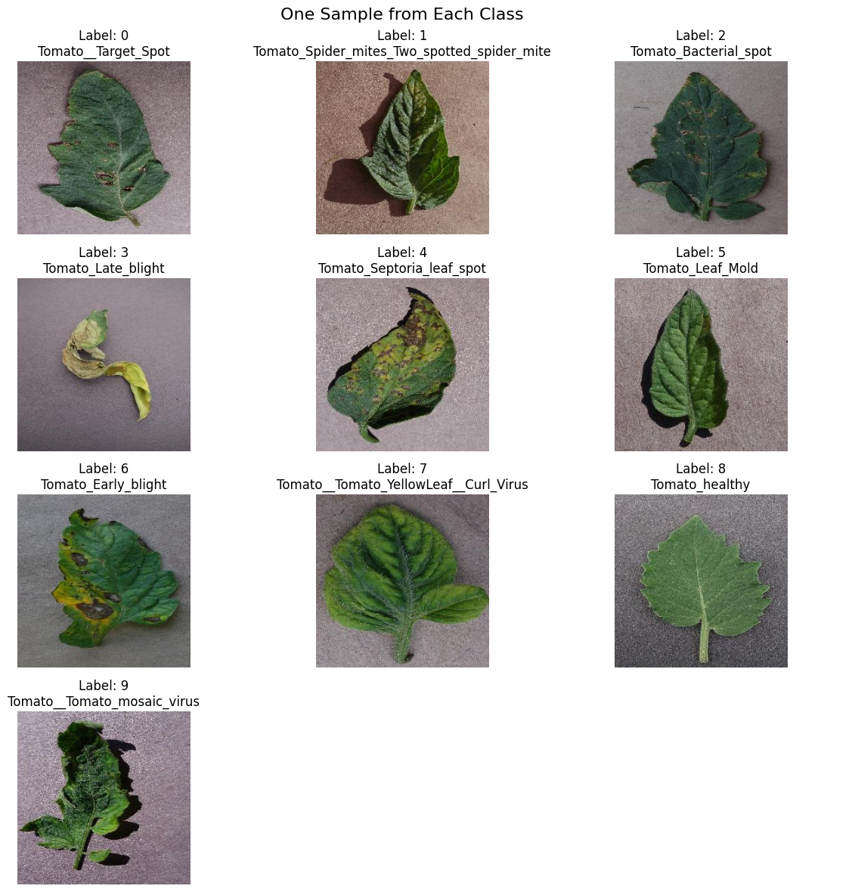
  <br>
  <p><em>Figure 1. One sample from each class with its label and name.</em></p>
</div>

Eight classes have 1,000 images, class 5 has 952, and class 9 (Mosaic Virus) has only 373 (about 4%). The data is split 80/20 with stratification (`random_state=42`), giving 7,460 training and 1,865 validation images. Minority classes in the training split are then augmented to 800 images each (8,000 total). Samples are drawn without replacement first, so every unique image is used before any repeat. The validation set stays unbalanced (8 classes x 200, class 5 x 190, class 9 x 75).

<div align="center">
  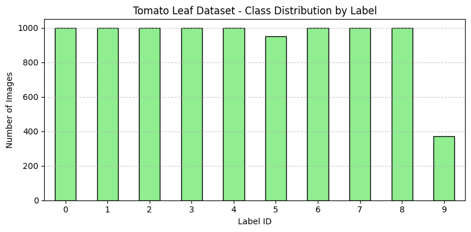
  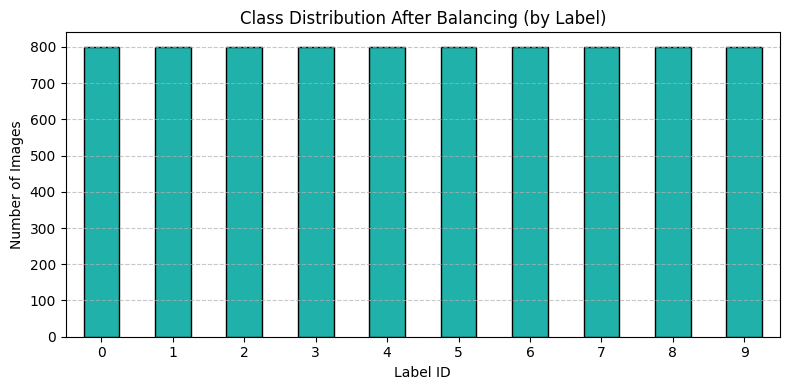
  <br>
  <p><em>Figure 2. Class distribution before splitting (left) and in the training set after balancing (right).</em></p>
</div>

---

# Methodology

## 3.1 Pipeline

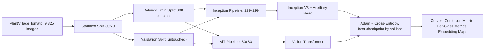

## 3.2 Preprocessing and Augmentation

| Stage | Pipeline |
|-------|----------|
| Offline balancing (minority classes only) | `RandomHorizontalFlip(p=0.75)`, `RandomResizedCrop(256, scale=(0.9, 1.0))`, `ColorJitter(brightness=0.1)` |
| Online training | `RandomHorizontalFlip`, `RandomResizedCrop(256, scale=(0.9, 1.0))`, `Resize`, `ToTensor`, `Normalize` |
| Online validation | `Resize`, `ToTensor`, `Normalize` |

Normalization uses ImageNet statistics. Images are resized to **299x299 for Inception-V3** and **80x80 for ViT**, which allows an exact 10x10 grid of 8x8 patches (the paper's 64x64 input cannot produce 100 patches of that size).

## 3.3 Inception-V3

The `torchvision` Inception-V3 is randomly initialized (`pretrained=False`) with `aux_logits=True`, and both heads are replaced for 10 classes.

| Component | Configuration |
|-----------|---------------|
| Main head | `Linear(2048, 1024)`, `ReLU`, `Dropout(0.3)`, `Linear(1024, 10)` |
| Auxiliary head | `Linear(768, 512)`, `ReLU`, `Dropout(0.3)`, `Linear(512, 10)` |
| Loss | `CE(main) + 0.4 x CE(aux)` in training; main output only at inference |
| Parameters | **26.85M** |

## 3.4 Vision Transformer

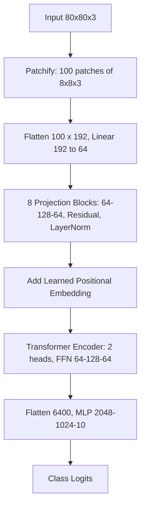

| Component | Configuration |
|-----------|---------------|
| Patch embedding | `Linear(192, 64)` on 100 patches |
| Projection blocks | 8 blocks, `64 -> 128 -> 64`, residual, `LayerNorm`, dropout 0.1 |
| Positional embedding | `nn.Embedding(100, 64)`, `trunc_normal_` init (`std=0.02`) |
| Transformer encoder | 1 block, 2 attention heads |
| Classifier | `6400 -> 2048 -> 1024 -> 10`, ReLU, dropout 0.3 |
| Parameters | **15.40M** |

## 3.5 Training Setup

| Setting | Inception-V3 | Vision Transformer |
|---------|--------------|--------------------|
| Input / batch size | 299x299 / 32 | 80x80 / 256 |
| Optimizer | Adam, `lr=1e-4`, `eps=1e-7`, no weight decay | Same |
| Epochs | 30 | 30 |
| Loss | CE + 0.4 x auxiliary CE | CE |
| Time per epoch | ~47 s | ~4-7 s |
| Model selection | Lowest validation loss | Lowest validation loss |

The Inception-V3 learning rate was chosen with a 4-epoch sweep over `{0.1, 0.01, 0.001, 0.0001}`, which gave 9.7%, 30.3%, 84.4%, and 86.5% training accuracy respectively.

---

# Results and Evaluation

## 4.1 Overall Comparison

| Model | Parameters | Input | Validation Accuracy | Macro F1 |
|-------|-----------:|-------|--------------------:|---------:|
| **Inception-V3** | 26.85M | 299x299 | **97.27%** | **0.973** |
| Vision Transformer | 15.40M | 80x80 | 93.51% | 0.936 |

## 4.2 Training Curves

<div align="center">
  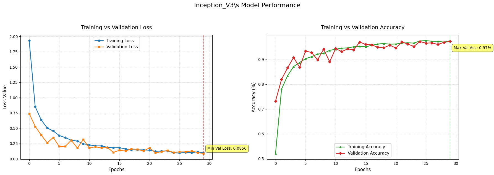
  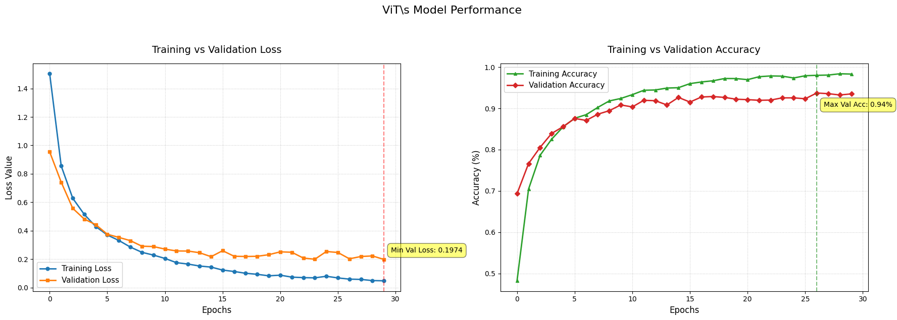
  <br>
  <p><em>Figure 3. Loss and accuracy over 30 epochs for Inception-V3 (left) and the ViT (right).</em></p>
</div>

At epoch 30, Inception-V3 reaches about 97.5% training and 97.3% validation accuracy. The ViT reaches about 98.3% training but 93.5% validation accuracy, a clearly larger generalization gap.

## 4.3 Per-Class Performance

| Class | Name | Support | Inception F1 | ViT F1 | Inception Recall | ViT Recall |
|:-----:|------|--------:|-------------:|-------:|-----------------:|-----------:|
| 0 | Target Spot | 200 | 0.9645 | 0.9044 | 0.9500 | 0.8750 |
| 1 | Spider Mites | 200 | 0.9681 | 0.9291 | 0.9850 | 0.9500 |
| 2 | Bacterial Spot | 200 | 0.9824 | 0.9363 | 0.9750 | 0.9550 |
| 3 | Late Blight | 200 | 0.9698 | 0.9114 | 0.9650 | 0.9000 |
| 4 | Septoria Leaf Spot | 200 | 0.9657 | 0.9435 | 0.9850 | 0.9600 |
| 5 | Leaf Mold | 190 | 0.9869 | 0.9468 | 0.9895 | 0.9368 |
| 6 | Early Blight | 200 | 0.9482 | 0.8901 | 0.9150 | 0.8500 |
| 7 | Yellow Leaf Curl Virus | 200 | 0.9728 | 0.9563 | 0.9850 | 0.9850 |
| 8 | Healthy | 200 | 0.9925 | 0.9875 | 0.9950 | 0.9850 |
| 9 | Mosaic Virus | 75 | 0.9804 | 0.9548 | 1.0000 | 0.9867 |

## 4.4 Confusion Matrices

<div align="center">
  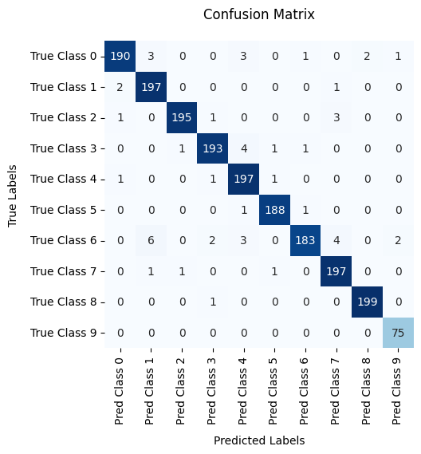
  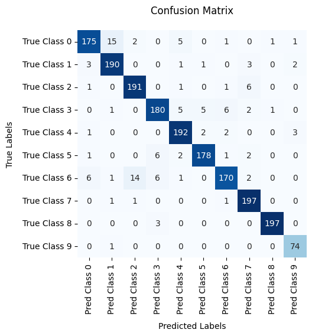
  <br>
  <p><em>Figure 4. Validation confusion matrices for Inception-V3 (left) and the ViT (right).</em></p>
</div>

## 4.5 ViT Embedding Visualizations

<div align="center">
  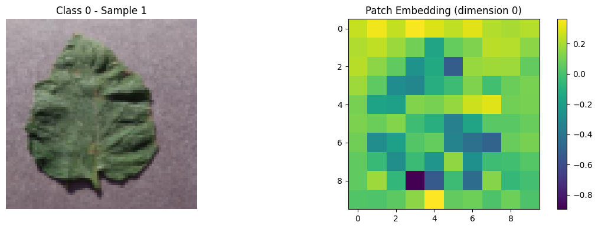
  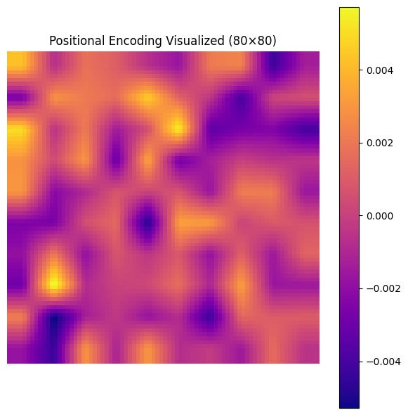
  <br>
  <p><em>Figure 5. Left: image and patch-embedding dimension 0 on the 10x10 grid (class 0; all ten classes are in <code>assets/</code>). Right: learned positional embedding (mean over 64 dimensions) upsampled to 80x80.</em></p>
</div>

## 4.6 Discussion

* **Accuracy:** Inception-V3 is about 3.8 points more accurate and leads on every class. Both models find Healthy easiest and Early Blight hardest.
* **Efficiency:** the ViT has about 43% fewer parameters and trains roughly 10x faster per epoch, which suits resource-limited settings if a small accuracy loss is acceptable.
* **Data efficiency:** the convolutional locality prior helps when training from scratch, whereas the ViT must learn spatial structure itself and overfits more.
* **Caveats:** the models use different input resolutions (299 vs. 80), which may account for part of the gap. The validation set is also used for checkpoint selection and there is no separate test set, so the figures are slightly optimistic.

---

# Tools, Structure, and Installation

**Stack:** Python 3.10+, PyTorch, Torchvision, TorchMetrics, scikit-learn, Pandas, PyArrow, NumPy, Pillow, Matplotlib, Seaborn, Hugging Face Hub, Git LFS, Google Colab.

```text
Tomato-Leaf-Disease-Classification-with-Vision-Transformer-and-Inception-V3
│
├── tomato_leaf_disease_vit_vs_inception.ipynb   # Main implementation notebook
├── assets/                                      # Figures exported from notebook outputs
├── requirements.txt                             # Dependencies
├── LICENSE
└── README.md
```

```bash
# 1. Clone the repository
git clone https://github.com/farzadjannati/Tomato-Leaf-Disease-Classification-with-Vision-Transformer-and-Inception-V3.git
cd Tomato-Leaf-Disease-Classification-with-Vision-Transformer-and-Inception-V3

# 2. Create and activate a virtual environment
conda create -n tomato-vit python=3.10
conda activate tomato-vit

# 3. Install required packages
pip install -r requirements.txt
# Core deps: torch, torchvision, torchmetrics, scikit-learn, pandas, pyarrow, seaborn, matplotlib, tqdm, pillow

# 4. Download the dataset (requires Git LFS)
git lfs install
git clone https://huggingface.co/datasets/ArianFiroozi/NNDL_HW5_S2025
```

**Reproducibility:** run the notebook cells sequentially. A CUDA GPU is strongly recommended (for example a Colab GPU runtime). The split and balancing use seed `42`; weights are randomly initialized, so accuracy can vary slightly between runs.

---
# License

This project is licensed under the MIT License.

---

## Author

**Farzad Jannati**
M.Sc. Student, University of Tehran
Research Assistant @ Social Networks Lab

**Research Interests:** NLP, Large Language Models (LLMs), Vision-Language Models, Adversarial Robustness, Parameter-Efficient Fine-Tuning, Agentic AI, Retrieval-Augmented Generation (RAG)

📧 [farzadjannati@ut.ac.ir](mailto:farzadjannati@ut.ac.ir) | 💻 [github.com/farzadjannati](https://github.com/farzadjannati) | 💼 [linkedin.com/in/farzadjannati](https://www.linkedin.com/in/farzadjannati)

---

# Support

If you find this project useful, consider giving it a star ⭐

---

<p align="center">
  Built with ❤️ using PyTorch, Torchvision, TorchMetrics, and Scikit-learn
</p>
